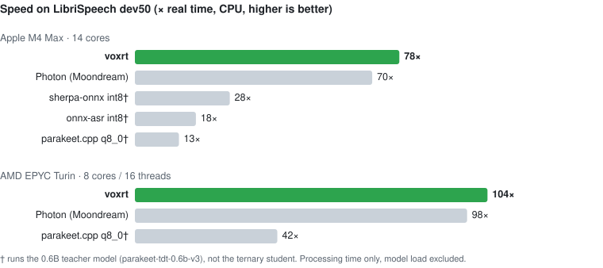

<div align="center">

<picture>
  <source media="(prefers-color-scheme: dark)" srcset="assets/logo-dark.svg">
  
</picture>

**Fast, deterministic speech-to-text on the CPU — a Rust runtime for [Parakeet Redux](https://huggingface.co/moondream/parakeet-redux).**

[](LICENSE)
[](https://www.rust-lang.org)
[](bindings/python)
[](#hardware-support)
[](https://huggingface.co/moondream/parakeet-redux)

[Quick start](#quick-start) · [Benchmarks](#benchmarks) · [Python](#python) · [Swift](#swift) · [C](#c) · [How it works](#how-it-works)

</div>

**voxrt** runs [moondream/parakeet-redux](https://huggingface.co/moondream/parakeet-redux) — the 1.58-bit ternary
distillation of NVIDIA's Parakeet-TDT 0.6B (25 languages, 178 MB) — with native ternary kernels:

- **Fast on ordinary CPUs** — 78× real time on an M4 Max, 104× on an AMD Turin server; faster than the model vendor's own runtime on both
- **Native ternary kernels** — NEON `smmla` / `sdot` on Apple Silicon, AVX-512 VNNI / AVX2 on x86, picked at run time
- **Apple GPU by default** — on Apple Silicon the encoder runs on the GPU (Metal): 2.8× faster than on the CPU, 2× faster than Moondream's own GPU runtime, under one CPU core busy and ~8× less energy
- **Same bits everywhere** — byte-identical transcripts on Apple Silicon and x86; every SIMD kernel equals its scalar reference
- **Long audio built in** — the model's own VAD head segments talks and meetings; segment and word timestamps, SRT and JSON
- **Streaming** — push audio as it arrives; the output equals the offline transcript
- **Small and embeddable** — pure Rust with a handful of small crates; no ONNX, Python or ML-framework runtime; CLI, Python, Swift and C bindings
- **Accurate** — LibriSpeech test-clean WER 1.95 (the model card's 1.96), scored with the Open ASR Leaderboard normaliser

## Benchmarks

<picture>
  <source media="(prefers-color-scheme: dark)" srcset="assets/bench-dark.svg">
  
</picture>

**Apple M4 Max** (14 cores, macOS 26)

| Workload | voxrt GPU (default) | voxrt CPU | Photon GPU | Photon CPU |
|---|---|---|---|---|
| dev50, 50 short clips | **202×** · WER 1.78 (171× on the Neural Engine) | 72× · WER 1.68 | 100× · WER 1.78 | 71× · WER 1.68 |
| LibriSpeech test-clean, 2,620 utterances | **197× · WER 1.96** | 79× · WER 1.95 | — | 51× · WER 1.96 |
| one 27 s utterance | **0.11 s (250×)** | 0.26 s (104×) | — | 0.37 s (72×) |
| TED-LIUM 3 long-form, 148 min | **174× · WER 2.54** | 92× · WER 2.55 | — | 65× · WER 2.52 |

**What a Mac app pays per transcription** (same M4 Max, from `bench/prod_bench.py`)

| | voxrt GPU | voxrt CPU |
|---|---|---|
| 2 s clip, first call / warm | 18 / 17.5 ms | 45 / 43 ms |
| 10 s clip | 43 ms | 114 ms |
| CPU cores busy while transcribing | 0.6–0.9 | ~10 |
| macOS energy impact per audio-minute (sustained) | **75** | 586 |
| peak memory, 5 s / 60 s clip | 0.46 / 0.81 GB | 0.30 / 0.78 GB |

**AMD EPYC 9B45 Turin** (Google Cloud `c4d-standard-16`: 8 cores / 16 threads, Ubuntu 24.04)

| Workload | voxrt | Photon (Moondream) | parakeet.cpp q8_0 (teacher model) |
|---|---|---|---|
| LibriSpeech test-clean, 2,620 utterances | **105× · WER 1.95** | 97× · WER 1.94 | — |
| dev50, 50 short clips | **104×** · WER 1.68 | 98× · WER 1.68 | 42× · WER 1.18 |

## Quick start

**Python** — the model downloads on first use:

```sh
pip install voxrt
```

```python
import voxrt

t = voxrt.Transcriber()                 # fetches moondream/parakeet-redux into the Hugging Face cache once
print(t.transcribe("talk.wav").text)
```

**Command line** — prebuilt `voxrt-<version>-darwin-universal` (Apple Silicon + Intel Macs) and `-linux-x86_64`
downloads on the releases page, or from source:

```sh
git lfs clone https://huggingface.co/moondream/parakeet-redux models/parakeet-redux
git lfs clone https://huggingface.co/MaksL/voxrt-parakeet-redux-coreml models/parakeet-redux/coreml   # optional, Neural Engine
cargo install --path crates/voxrt-cli
voxrt transcribe talk.wav
```

<details>
<summary>Other ways to install (Swift, C, from source)</summary>

```sh
# Swift (macOS / iOS): build the XCFramework, then add bindings/swift as a local package
scripts/build_xcframework.sh

# C: static and shared library plus header
cargo build --release -p voxrt-ffi          # → target/release/libvoxrt.{a,dylib,so}, include/voxrt.h

# Python from source
cd bindings/python && maturin develop --release
```

No build flags are needed: the x86 kernels are chosen at run time from the CPU's features.
</details>

## Usage

### Command line

```sh
voxrt transcribe talk.wav                                   # WAV at any rate, any channels, PCM or float
voxrt transcribe talk.wav --timestamps word --format json   # segments + words
voxrt transcribe talk.wav --format srt > talk.srt           # subtitles
cat talk.wav | voxrt transcribe - --quiet                   # stdin
voxrt transcribe talk.wav --threads 4 --precision f32       # thread count; exact fp32 reference path
```

Set `VOXRT_MODEL_DIR` (or pass `--model`) to point at the model directory.

### Device

On Apple Silicon the encoder runs on the GPU (Metal) by default; elsewhere, and on Intel Macs, on the CPU.

```sh
voxrt transcribe talk.wav                     # auto: GPU on Apple Silicon
VOXRT_DEVICE=cpu voxrt transcribe talk.wav    # the CPU path (byte-identical across Apple Silicon and x86)
```

Python takes `voxrt.Transcriber(device="auto" | "gpu" | "cpu")` and reports `t.device`; Swift and C read
`VOXRT_DEVICE` when the model loads. GPU transcripts follow the f32 reference path (WER 1.96 on test-clean) and are not
byte-identical to the int8 CPU path.

**Neural Engine.** On Apple silicon (macOS 15+) the encoder layers can run on the Apple Neural Engine, with the ternary
weights kept exact in 2 bits. It is opt-in (`VOXRT_DEVICE=ane`, Python `device="ane"`) and needs a Core ML bundle (≈ 300
MB, fp16 compute): Python downloads
[`MaksL/voxrt-parakeet-redux-coreml`](https://huggingface.co/MaksL/voxrt-parakeet-redux-coreml) on first use; for the
CLI, Swift and C, clone it into `<model>/coreml` (or point `VOXRT_COREML_DIR` at it), or build it with
[`tools/coreml/convert_encoder.py`](tools/coreml/README.md). macOS compiles the bundle for the Neural Engine on first
load (≈ 4.7 min, cached afterwards; later loads ≈ 20 s). M4 Max: dev50 171×, test-clean 168× (WER 1.96), TED-LIUM
long-form 110× (WER 2.53). The M4 Max's 40-core GPU is faster on inputs over ≈ 5 s, so `VOXRT_ANE_MAX_FRAMES=64` sends
only those to the Neural Engine there; on chips with a smaller GPU the Neural Engine keeps the lead to longer inputs.

### Python

```python
import voxrt

t = voxrt.Transcriber()                       # or voxrt.Transcriber("/path/to/parakeet-redux")
r = t.transcribe("talk.mp3")                  # WAV natively; FLAC/OGG/MP3 with `pip install voxrt[audio]`; others via ffmpeg
print(r.text)
for s in r.segments:                          # Segment(start, end, text, words=[Word(word, start, end)])
    print(f"[{s.start:6.2f} → {s.end:6.2f}] {s.text}")

r = t.transcribe(samples, sample_rate=48000)  # numpy array: mono, or [n, channels]
```

Results are frozen dataclasses with type hints. The GIL is released while transcribing, so one `Transcriber` can serve
several threads.

### Streaming

```python
st = t.stream()
for chunk in microphone_chunks_16k():         # float32, 16 kHz mono
    for seg in st.push(chunk):                # segments are emitted as soon as their end is certain
        print(seg.text)
for seg in st.flush():
    print(seg.text)
```

Segments close only once the following pause is known, so the streamed transcript is identical to the offline one.

### Swift

```swift
import Voxrt

let t = try Transcriber(modelDir: "/path/to/parakeet-redux")
let r = try t.transcribe(path: "talk.wav")
print(r.text)
for s in r.segments { print(s.start, s.end, s.text) }
```

The XCFramework carries macOS (universal), iOS and iOS-simulator slices.

### C

```c
#include "voxrt.h"

VoxrtTranscriber *t = voxrt_new("/path/to/parakeet-redux");
VoxrtTranscript *r = voxrt_transcribe_file(t, "talk.wav");
printf("%s\n", r->text);
voxrt_transcript_free(r);
voxrt_free(t);
```

Errors return `NULL`; `voxrt_last_error()` describes them. Streaming: `voxrt_stream_new` / `_push` / `_flush`.

## Hardware support

| CPU | Kernel | Status |
|---|---|---|
| Apple M2 and later, ARMv8.6 with I8MM | NEON `smmla` 8×8 tiles, 2-bit packed weights | measured (M4 Max) |
| Apple M1, ARMv8.2+ with dot product | NEON `sdot` tiles | tested (forced on the M4) |
| x86-64 with AVX-512 VNNI (AMD Zen 4/5, Intel Xeon since Cascade Lake, Ice / Tiger / Rocket Lake) | `vpdpbusd` on a 16-row layout | measured (Genoa, Turin) |
| x86-64 with AVX2 + FMA (Intel since Haswell incl. 12th–14th gen and Core Ultra, AMD since Zen 1) | `vpmaddubsw` | measured (Genoa) |
| anything else | portable scalar | correct, slow |

- [x] macOS — universal binaries (Apple Silicon and Intel)
- [x] iOS / iPadOS — XCFramework
- [x] Linux x86-64
- [ ] Linux arm64, Windows — planned
- [x] Apple GPU (Metal) — encoder and subsampling on Apple-silicon GPUs, the default there
- [x] Apple Neural Engine (Core ML) — exact 2-bit ternary weights on the Neural Engine, opt-in; prebuilt bundle on
  Hugging Face

## How it works

- **Kernels.** Ternary weights are repacked at load (2-bit planes on I8MM, 429 MB resident); activations are quantised
  to int8 per token and 128-column group. GEMMs, the attention scores and the attention context all run in int8.
- **Exactness.** Integer group sums are exact and the float steps run in a fixed order, so every SIMD kernel matches
  the scalar reference bit for bit, and Apple Silicon and x86 produce the same transcript.
- **Decoder.** TDT greedy decoding with NeMo's semantics; int8 joint head and LSTM on a dedicated single-token GEMV.
- **Long-form.** The model's VAD head cuts audio at pauses into 10–60 s segments; the encoder (all cores) overlaps with
  the decoder (one core). Streaming feeds the same segment automaton as offline transcription.
- **GPU.** On Apple Silicon the subsampling and the 24 encoder layers run as Metal compute kernels in one command
  buffer: ternary weights stay 2-bit on the GPU and are decoded inside the GEMM (simdgroup matrix tiles, split-K for the
  wide projections); the decoder stays on the CPU.
- **Accuracy.** The fp32 path is token-identical to the Python reference on all of LibriSpeech test-clean (WER 1.96, the
  model card's number). int8 scores 1.95; the transcripts that differ from fp32 are near-ties the int8 path gets
  right as often as fp32.

## Limitations

- **The model.** A distilled 1.58-bit student: on clean read speech it is ~0.4 WER behind its teacher, and the card
  reports a larger gap on noisy audio. voxrt does not change that.
- **Evaluation** is English so far (LibriSpeech, TED-LIUM); the model covers 25 languages and voxrt decodes them, but
  they have not been scored.
- **Streaming latency.** The first segment arrives once the following pause is known (≥ 10 s of speech).
- **Memory.** ~0.3 GB (CPU) / 0.46 GB (GPU) on short clips, ~0.8 GB on a 60 s segment, more on long talks.
- **Intel CPUs** use the same AVX2 / AVX-512 kernels but have not been benchmarked; 256-bit AVX-VNNI (Intel 12th gen
  and later) is not used yet.
- **GPU mode** is f32 and agrees with the f32 reference, so its transcripts differ from the default int8 CPU path in a
  few near-ties; only the CPU paths are byte-identical across machines.

## Development

<details>
<summary>Tests, accuracy and benchmark scripts</summary>

```sh
cargo test --release                          # unit, exactness and golden-parity tests (golden ones skip without golden/ and models/)
scripts/wer.sh dev50                          # leaderboard-exact WER through the CLI (dev50 | test-clean)
bench/.venv/bin/python bench/run_all.py       # same-machine benchmark of all runtimes
pytest bindings/python/tests                  # Python package (VOXRT_TEST_DOWNLOAD=1 fetches the model)
scripts/c_smoke.sh · swift run VoxrtSmoke     # C and Swift smoke tests
```

x86 kernels can be checked on an Apple Silicon Mac under Rosetta (`ROSETTA_ADVERTISE_AVX=1` exposes AVX2);
`scripts/x86/` holds the cloud-box scripts used for the AVX-512 measurements.
</details>

## Acknowledgements

voxrt is an independent implementation built from the CC-BY model repository, NVIDIA NeMo, Hugging Face Transformers
and public papers; Moondream's Photon runtime is used only as a black-box benchmark.

- Model weights © NVIDIA and M87 Labs (Moondream), [CC-BY-4.0](https://huggingface.co/moondream/parakeet-redux).
- Text normaliser vendored from the [Open ASR Leaderboard](https://github.com/huggingface/open_asr_leaderboard) (Apache-2.0).
- Papers: TDT ([arXiv:2304.06795](https://arxiv.org/abs/2304.06795)), FastConformer ([arXiv:2305.05084](https://arxiv.org/abs/2305.05084)),
  BitNet b1.58 ([arXiv:2402.17764](https://arxiv.org/abs/2402.17764)).

## License

voxrt is released under the [Apache License 2.0](LICENSE). The model weights it runs are licensed separately (CC-BY-4.0).

## Citation

```bibtex
@software{voxrt,
  title  = {voxrt: a fast, deterministic CPU runtime for ternary Parakeet speech recognition},
  author = {Lypivskyi, Maksym},
  year   = {2026}
}
```
